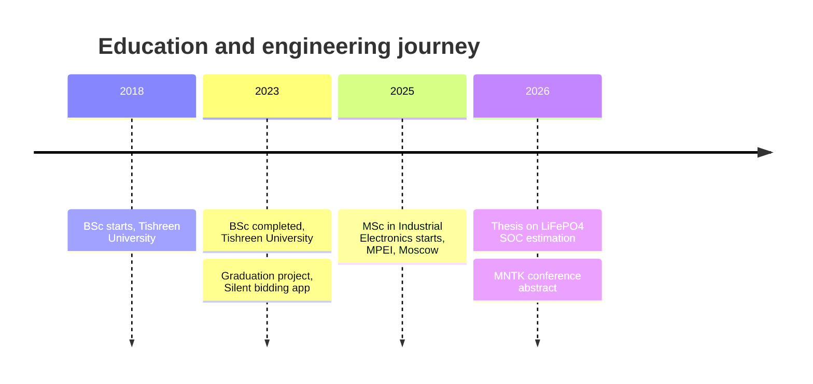

# Ali Isber

**Embedded & Battery-Management Researcher | MSc student at MPEI | Flutter Developer**

  
  
  
  

Automatic control and computer engineer from Syria (Tishreen University), now studying for a master's degree in Industrial Electronics at the National Research University "Moscow Power Engineering Institute" (MPEI). My research is about state-of-charge (SOC) estimation for LiFePO4 batteries and running those estimators on microcontrollers in battery-management systems (BMS). Before that I built mobile apps with Flutter and Firebase.

**Explore:** [Research](#research) · [Projects](#projects) · [Tools](#tools) · [Education](#education)

## Research

### SOC estimation for LiFePO4 batteries

**Master's thesis, MPEI · Supervisor: A. N. Smirnov, PhD**

LiFePO4 cells have a long, flat OCV–SOC plateau, where a 1 mV error in the curve can shift the SOC estimate by about 5 %. My work compares SOC estimation methods on open CALCE A123 test data and looks at how to run them on a BMS microcontroller.

- **Done:** baseline coulomb counting with OCV reset in MATLAB, with automatic drive-segment detection, a reference SOC and error metrics over a set of experiments.
- **In progress:** an extended Kalman filter (1RC model) whose measurement noise follows the local slope of the OCV–SOC curve, so the filter relies on coulomb counting on the plateau. Hysteresis is handled with separate charge and discharge OCV curves.
- **Next:** comparison with constant-parameter EKF and data-driven methods, then an STM32 implementation with memory and timing measurements.

**Conference abstract:** *SOC estimation of LiFePO4 batteries with a Kalman filter that accounts for the slope of the OCV–SOC curve*, MPEI student conference (MNTK).

### Digital signal processing for protection and measurement

**[dsp-mathcad-practicals](https://github.com/aesberali-boop/dsp-mathcad-practicals)**: Mathcad studies of amplitude and impedance estimation algorithms (DFT, differential-equation and time-delay methods) under frequency deviation, decaying DC and harmonics, for the MPEI course *Microprocessor systems for data acquisition and display*.

## Projects

### Flutter + Firebase apps

| App | What it does | Repository |
| --- | --- | --- |
| **Silent** | Bidding (auction) app · BSc graduation project | [silent →](https://github.com/aesberali-boop/silent) |
| **Shop** | E-commerce shop | [flutter-shop-app →](https://github.com/aesberali-boop/flutter-shop-app) |
| **Hotel** | Hotel room management | [flutter-hotel-app →](https://github.com/aesberali-boop/flutter-hotel-app) |
| **Library** | Books and writers catalogue (Firestore) | [flutter-library-app →](https://github.com/aesberali-boop/flutter-library-app) |
| **Pharmacy** | Medicines catalogue (Firestore) | [flutter-pharmacy-app →](https://github.com/aesberali-boop/flutter-pharmacy-app) |
| **Todo** | Tasks app (Firestore) | [flutter-todo-app →](https://github.com/aesberali-boop/flutter-todo-app) |
| **Auth** | Sign-up and login with Cubit state management | [flutter-auth-app →](https://github.com/aesberali-boop/flutter-auth-app) |

## Tools

        

- **Battery management:** SOC estimation (coulomb counting, OCV methods, Kalman filters), equivalent-circuit models, OCV–SOC hysteresis.
- **Signal processing:** amplitude, phasor and impedance estimation algorithms for measurement and protection.
- **Embedded:** microcontroller implementation of estimation algorithms (STM32).
- **Mobile:** Flutter, Dart, Firebase Auth and Cloud Firestore, Cubit/Bloc state management.

## Education

**MSc in Industrial Electronics, MPEI, Moscow** | 2025–present

Thesis: *Research of state-of-charge estimation methods for LiFePO4 batteries and their implementation in control systems.* Supervisor: A. N. Smirnov, PhD, Associate Professor.

**BSc in Automatic Control and Computer Engineering, Tishreen University, Syria** | 2018–2023

Graduation project: [Silent](https://github.com/aesberali-boop/silent), a bidding (auction) app built with Flutter and Firebase.
